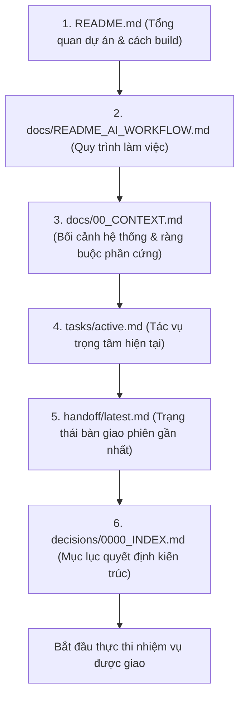

# AI Workspace Standard Specification (AWS-01)

> **Phiên bản:** 1.0.0  
> **Trạng thái:** Active / Official Standard  
> **Áp dụng cho:** Toàn bộ Repository trong hệ sinh thái AI Workspace (Bao gồm các dự án phần mềm, firmware robot, UI, công cụ nội bộ).

---

## 1. Mục tiêu và Nguyên lý cốt lõi

Trong môi trường phát triển hiện đại có sự tham gia sâu rộng của các AI Coding Agents (**Claude Code**, **Google Antigravity**, **OpenAI Codex**...) làm việc đa máy (Multi-Machine: Windows / Linux / macOS) và đa phiên (Multi-Session):

1. **Repo là nguồn chân lý duy nhất (Single Source of Truth):**  
   Mọi trạng thái, bối cảnh, quyết định kỹ thuật và tiến độ công việc đều phải nằm trực tiếp trong repository dưới dạng các tệp văn bản thuần (Markdown). Khi chuyển máy hoặc chuyển agent, toàn bộ ngữ cảnh được khôi phục 100% từ repo mà không phụ thuộc vào bộ nhớ đám mây của riêng một công cụ nào.

2. **Quy tắc an toàn và tôn trọng ngữ cảnh (Safety & Non-Destructive):**  
   AI Agent tuyệt đối không tự ý viết đè hoặc tái cấu trúc (refactor) các phần mã nguồn đã ổn định nếu không có quyết định kiến trúc được ghi nhận trong `decisions/`.

3. **Thứ tự đọc bắt buộc (Mandatory Reading Order):**  
   Mọi AI Agent khi khởi tạo phiên làm việc trong repository **phải đọc các tệp chỉ dẫn theo đúng thứ tự nghiêm ngặt** trước khi đọc hoặc thay đổi bất kỳ dòng mã nào.

---

## 2. Cây thư mục tiêu chuẩn (Standard Directory Structure)

Mỗi repository chuẩn trong workspace phải có cấu trúc cây tối thiểu như sau:

```text
<repository_root>/
├── handoff/                          # Quản lý bàn giao phiên làm việc & đồng bộ đa máy
│   └── latest.md                     # File bàn giao duy nhất, luôn phản ánh trạng thái mới nhất
├── decisions/                        # Architecture Decision Records (ADR)
│   ├── 0000_INDEX.md                 # Bảng mục lục tất cả quyết định kiến trúc
│   └── 0001_<decision_title>.md      # Chi tiết từng quyết định kỹ thuật
├── docs/                             # Tài liệu bối cảnh, đặc tả và quy chuẩn
│   ├── 00_CONTEXT.md                 # Bối cảnh hệ thống, thông số phần cứng, các repo liên kết
│   ├── README_AI_WORKFLOW.md         # Hướng dẫn chi tiết quy trình phối hợp cho AI & con người
│   └── AI_WORKSPACE_STANDARD.md      # Quy chuẩn chung này (hoặc symlink / tham chiếu)
├── tasks/                            # Quản lý tác vụ dạng file (File-based Kanban)
│   ├── active.md                     # Tác vụ đang thực hiện trong phiên hiện tại
│   ├── backlog.md                    # Hàng đợi các tác vụ cần làm
│   ├── blocked.md                    # Tác vụ bị nghẽn (chờ phần cứng, chờ quyết định)
│   ├── bugs.md                       # Các lỗi đã xác nhận cần xử lý
│   └── done.md                       # Lịch sử các tác vụ đã hoàn thành và nghiệm thu
├── outputs/                          # Nơi lưu trữ artifact đầu ra của AI (tránh làm bẩn repo)
│   ├── claude_drafts/                # Bản thảo tài liệu, ý tưởng thiết kế
│   ├── code_reviews/                 # Báo cáo rà soát mã nguồn
│   ├── debug_reports/                # Log kiểm tra, phân tích lỗi, trace đống
│   └── temporary/                    # Các file dữ liệu tạm thời trong quá trình chạy
├── AGENTS.md                         # Chỉ dẫn và luật cho Codex / Antigravity / AI Agent chung
├── CLAUDE.md                         # Chỉ dẫn và luật cho Claude Code CLI
└── README.md                         # Giới thiệu tổng quan dự án cho con người
```

---

## 3. Thứ tự đọc bắt buộc đối với AI Agent

Trước khi phân tích hoặc chỉnh sửa mã nguồn, AI Agent bắt buộc phải đọc lần lượt 6 tệp sau:



---

## 4. Bảng phân định trách nhiệm các thành phần

| Thư mục / Tệp | Vai trò chính | Tần suất cập nhật | Ai cập nhật |
|---|---|---|---|
| `handoff/latest.md` | Bàn giao tiến độ, file đã sửa, bước tiếp theo | **Mỗi khi kết thúc session** hoặc chuyển máy | AI Agent + NdevTool |
| `decisions/` | Ghi nhận quyết định kiến trúc cốt lõi | Khi có thay đổi lớn về thiết kế / stack | Con người + AI (sau khi thảo luận) |
| `tasks/active.md` | Chi tiết công việc đang làm, tiêu chí hoàn thành | Khi bắt đầu hoặc chuyển đổi tác vụ | Con người & AI |
| `tasks/done.md` | Nhật ký việc đã hoàn tất và kiểm tra thực tế | Khi hoàn thành và xác minh xong tác vụ | Con người & AI |
| `docs/00_CONTEXT.md` | Bản đồ hệ thống, liên kết các repo anh em | Khi kiến trúc hoặc phần cứng thay đổi | Con người |
| `outputs/` | Nơi chứa file nháp, báo cáo review, debug logs | Trong quá trình làm việc phát sinh tài liệu phụ | AI Agent |
| `CLAUDE.md` / `AGENTS.md` | Luật biên cương của Repo (Safety rules & guidelines) | Khi thay đổi quy chuẩn phát triển | Tech Lead / Maintainer |

---

## 5. Quy tắc ứng xử và an toàn (Safety Guidelines)

1. **Không sửa các file ngoài phạm vi:**  
   AI Agent chỉ sửa đúng các file liên quan trực tiếp đến tác vụ trong `tasks/active.md`. Không tự tiện "dọn dẹp" hay format lại toàn bộ dự án làm bẩn Git diff.
2. **Quy tắc an toàn phần cứng / môi trường:**  
   Đối với các repo nhúng (như `robot_s_rtos`, `robot_rc_rtos`): Mặc định là Read-Only đối với phần cứng (không tự ý flash ROM, reset vi điều khiển, hoặc ghi đè bộ nhớ nếu chưa có lệnh rõ ràng của người điều khiển).
3. **Quy tắc nghiệm thu:**  
   Mọi thay đổi phải được kiểm tra (chạy test, build sạch 0 warning, smoke-check). Những gì đã kiểm tra trên máy thật phải ghi rõ vào `handoff/latest.md`; những gì chưa kiểm tra cũng phải liệt kê trung thực ở mục `Not done / not verified`.
