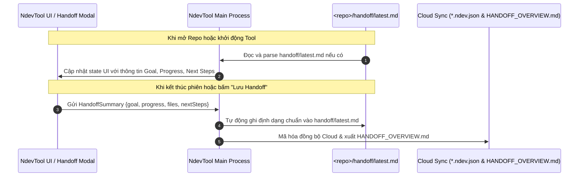

# Đặc tả Kỹ thuật Handoff (Handoff Specification)

> **Mã đặc tả:** AWS-SPEC-02  
> **Tài liệu tham chiếu:** `docs/00_AI_WORKSPACE_STANDARD.md`  
> **Tệp đích trên đĩa:** `<repo_root>/handoff/latest.md`

---

## 1. Mục đích của Handoff

Tệp `handoff/latest.md` là **điểm neo trạng thái** giữa các phiên làm việc của AI và giữa các máy tính khác nhau (ví dụ: đang code trên máy bàn Windows `win32-DESKTOP-I5PG2EK`, sau đó chuyển sang máy tính xách tay Linux `linux-ubuntu-dev`).

Khi mở một phiên mới:
1. Agent đọc `handoff/latest.md` để nắm bắt ngay: mục tiêu gần nhất là gì, tiến độ vừa làm được đến đâu, những tệp nào đã chỉnh sửa, và bước tiếp theo cần làm gì.
2. NdevTool tự động trích xuất các thông tin này để tiêm vào prompt khởi tạo (Handoff Prompt Injection) hoặc hiển thị trên giao diện trực quan cho lập trình viên.

---

## 2. Cấu trúc Markdown chuẩn của `handoff/latest.md`

Mọi tệp `handoff/latest.md` phải tuân thủ nghiêm ngặt định dạng Markdown sau:

```markdown
# Latest Handoff

## Date

YYYY-MM-DD (hoặc định dạng ngày giờ ISO)

## Machine / branch

- Machine: `<machine_node_id>` (Ví dụ: `win32-DESKTOP-I5PG2EK`)
- Branch: `<git_branch>` (Ví dụ: `main`)
- Updated: `YYYY-MM-DDTHH:mm:ss.sssZ`

## Current Goal

Mô tả ngắn gọn mục tiêu công việc của phiên hiện tại hoặc yêu cầu mới nhất từ người dùng (1-3 câu).

## Latest change / Recent progress

Tóm tắt các kết quả kỹ thuật vừa hoàn thành trong phiên gần nhất:
- Các tính năng đã viết, các lỗi đã sửa.
- Kết quả chạy test, build hoặc kiểm thử thực tế.

## Touched Files

Danh sách các tệp mã nguồn hoặc cấu hình vừa được tạo hoặc chỉnh sửa:
- `path/to/file1.ext`
- `path/to/file2.ext`

## Not done / not verified / Open risks

Những điểm còn dang dở hoặc chưa được thử nghiệm thực tế:
- Phần chưa viết xong hoặc cần chờ điều kiện phần cứng.
- Rủi ro kỹ thuật hoặc việc cần kiểm tra kỹ trước khi đưa vào sản xuất.

## Next

Chỉ dẫn cụ thể cho phiên tiếp theo (hoặc trỏ tới `tasks/active.md`):
- Hành động kế tiếp cần thực hiện ngay khi bắt đầu phiên mới.
```

---

## 3. Quy chuẩn Parser và Serializer 2 chiều trong NdevTool

NdevTool tự động đồng bộ 2 chiều giữa dữ liệu nội bộ (`repo.handoff`) và tệp `<repo_root>/handoff/latest.md`:



### Thuật toán phân tích cú pháp (Parser Rules):
1. **Current Goal:** Trích xuất nội dung nằm dưới đề mục `## Current Goal`. Nếu không có, tìm kiếm nội dung dưới `## Session ...` hoặc câu mở đầu.
2. **Recent Progress:** Trích xuất nội dung nằm dưới `## Latest change` hoặc `## Recent progress`.
3. **Touched Files:** Tìm kiếm các đường dẫn nằm trong danh sách gạch đầu dòng `- ` hoặc các từ nằm trong dấu backtick `` `path/file` `` dưới đề mục `## Touched Files`.
4. **Next Steps:** Trích xuất nội dung dưới đề mục `## Next` hoặc `## Not done`.

### Thuật toán xuất bản (Serializer Rules):
- Khi lưu từ NdevTool ra đĩa, luôn tự động bảo tồn đầy đủ các đề mục chuẩn.
- Tự động gắn thẻ Node ID hiện tại (`os.platform() + '-' + os.hostname()`) và Git branch hiện tại.
